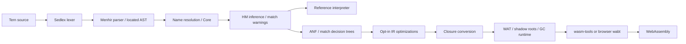

# Tern

**A small, typed functional language that compiles to WebAssembly.** Tern has
Hindley–Milner inference, first-class functions and closures, tuples, variants,
pattern matching, mutual recursion, and proper tail calls. The compiler is
written in OCaml; the browser playground runs that same compiler as JavaScript.

- [Language reference](LANGUAGE.md) · [Compiler and runtime design](DESIGN.md)
- [16 runnable examples](examples/README.md) · [Optimization measurements](OPTIMIZATIONS.md)
- [Project boundaries and verification](AGENTS.md)
- [Verification scope and current limits](VERIFICATION.md) · [Prioritized roadmap](ROADMAP.md)
- [MIT license](LICENSE)

## A short language tour

Bindings are inferred and functions are curried. Closures capture their lexical
environment; later shadowing does not change an existing closure.

```ocaml
let id x = x;;
let make_adder n = fun x -> n + x;;
let (answer, ready) = (make_adder 2 40, id true);;
let () = if ready then print_int answer else print_int 0;;
let () = print_string "\n";;
```

Variants can be parameterized, patterns can nest, and recursive functions need no
type annotations. Built-in lists are not special syntax: define them in Tern.

```ocaml
type 'a list = Nil | Cons of ('a * 'a list);;
let rec map f values = match values with
  | Nil -> Nil
  | Cons (head, tail) -> Cons (f head, map f tail);;
let numbers = map (fun x -> x + 1) (Cons (1, Cons (2, Nil)));;
```

Use `let rec ... and ...` for mutually recursive functions. Integers are signed
int32s with wrapping arithmetic; division/remainder by zero and min-int / -1 trap.
Strings hold bytes, `^` concatenates them, and print functions do **not** add a
newline. Sequencing requires a unit-valued left expression. Non-exhaustive and
unreachable patterns produce located warnings, not silent changes in behavior.

### A language interpreting a language

[`examples/interpreter.tern`](examples/interpreter.tern) defines an arithmetic
expression datatype, a recursive evaluator, and a recursive pretty-printer—all
in Tern. Its exact output is:

```text
(6 * (5 + 2)) = 42
(-(8 + 3)) = -11
((20 - 6) * 3) = 42
```

## Compiler pipeline



Every phase is a reusable library under `lib/`; `bin/ternc.ml` is the native CLI.
Diagnostics retain source spans throughout the front end. The AST and IR
interpreters are independent semantic references for the compiled backend.

## Build and run

Use the supplied repository-local environment and a read-only host C toolchain,
macOS SDK when applicable, and Node.js 22+. Nothing is installed globally.

```sh
scripts/setup.sh
scripts/check.sh
export PATH="$PWD/.tools/bin:$PWD/_opam/bin:$PATH"

dune exec ternc -- check examples/interpreter.tern --types
dune exec ternc -- run examples/interpreter.tern
dune exec ternc -- run --interp examples/interpreter.tern
dune exec ternc -- run --ir examples/interpreter.tern
```

Setup selects pinned local opam, OCaml 5.4.1 in `_opam/`, Dune dependencies, and
wasm-tools. Scripts preserve the supplied project-local HOME, TMPDIR, caches, and
SDK settings and reject state paths outside the repository. See
[DESIGN.md](DESIGN.md) for prerequisites and historical environment limitations.

To produce a binary or inspect intermediate forms:

```sh
dune exec ternc -- build examples/interpreter.tern -o .agent-local/interpreter.wasm
node runtime/run.mjs .agent-local/interpreter.wasm
dune exec ternc -- dump-ir examples/interpreter.tern
dune exec ternc -- dump-ir --closed examples/interpreter.tern
```

The default `run` compiles and executes through the Node host. A build is
assembled and validated before its output is published atomically. Failures keep
already-written stdout separate from diagnostics on stderr.

### Opt-in optimizations

`--inline`, `--const-fold`, `--match-simplify`, and `--dce` independently enable
small nonrecursive inlining, constant folding/propagation, known-constructor
decision simplification, and dead-code elimination. `--opt-all` runs them in that
order. Flags work with build, compiled/IR run, and dump-ir; defaults remain off.
The AST interpreter deliberately rejects optimization flags.

Each pass is tested independently and together. The five programs in
`benchmarks/` cover Fibonacci, sorting, a tree map, strings, and closures.
`OPTIMIZATIONS.md` preserves the original **pre-GC** measurements and explains how
to reproduce current measurements. Optimizations are not universal speedups and
do not promise identical allocation counts or exhaustion points.

## Garbage collection

The Wasm runtime now uses a **non-moving mark-sweep collector**, not an unbounded
bump allocator. Compiler-generated shadow frames root function arguments, bound
locals, case formals, and allocation scratch. Frames are released before tail
calls, preserving bounded stack/root usage. Collection uses an iterative worklist,
handles cyclic closure environments, skips string bytes, coalesces free blocks,
and grows linear memory only when retained data requires it. The cap is 64 MiB.
String literals are immutable static blocks outside the collected region.

`test/gc_cli.t` verifies over **256 MiB of cumulative allocation in 64 KiB of
linear memory**, both with and without optimizations. A separate 20,000-node live
list test verifies tracing and necessary growth. These are executed assertions,
not estimates of reclaimed memory. Roots conservatively retain bound locals until
their function exits; this is not a liveness-minimizing or compacting collector.

Native embedders holding exported runtime values across allocating calls must
register them with `rt_frame_push` / `rt_root_set` and release frames in LIFO order
with `rt_frame_pop`. JavaScript variables are not automatically Wasm GC roots.
The compiler does this automatically for Tern code. Layout, safepoints, counters,
and embedding requirements are specified in [DESIGN.md](DESIGN.md).

## Browser playground

CodeMirror 6, the js_of_ocaml compiler, wabt assembly, and Wasm execution are
bundled locally. Compilation/execution stays in a cancellable worker; no source
is uploaded and no native compiler endpoint is used.

```sh
npm ci --cache "$XDG_CACHE_HOME/npm" --no-audit --no-fund
scripts/build-site.sh
scripts/serve.sh
```

Open **http://127.0.0.1:21916**. Choose any example, edit, and press Run or
**⌘/Ctrl+Enter**; the same button stops execution. Panes show output, rendered
diagnostics with Unicode-correct editor highlights, inferred types, ANF IR, and
WAT. Editing clears stale results and cancels the previous run.

`site/` is a self-contained static HTTP site, including all 16 examples. Do not
open it with `file://`. Builds preserve installed dependencies and browser tools;
run `npm ci` explicitly when dependencies change. npm's project-local policy
approves only the pinned esbuild install script.

The playground has a five-second worker budget, 256 KiB source limit, 64 KiB
output limit, and 64 MiB Wasm memory cap. Output is decoded as UTF-8; invalid byte
sequences display replacement characters. Runtime traps are not yet source-mapped.
A modern browser with Wasm tail calls is required; Chromium is tested, Safari and
Firefox are not verified here.

## Testing strategy

Implemented does not mean exhaustively verified: the local native and Chromium
paths are exercised, while other platforms/browser engines remain unverified.
The collector is non-moving/conservative and compiled traps lack source spans.
Opam metadata now has MIT/owner fields and no lint errors; canonical homepage/
issue URLs remain pending rather than guessed. [VERIFICATION.md](VERIFICATION.md)
records commands and evidence; [ROADMAP.md](ROADMAP.md) prioritizes remaining
correctness, security, and release gaps before new features.

```sh
scripts/check.sh
scripts/build-site.sh
npm test
PLAYWRIGHT_BROWSERS_PATH="${PLAYWRIGHT_BROWSERS_PATH:-$PWD/.agent-local/browsers}" \
  node_modules/.bin/playwright install chromium --only-shell
npm run test:browser
```

- **Phase expectations:** stable `ppx_expect` tests for every compiler phase,
  including located errors, round trips, inference, closures, and Wasm emission.
- **Exact corpus:** every `.tern` in `examples/` and `tests/programs/` is compared
  byte-for-byte across AST, closed IR, and compiled Wasm. Failure cases also check
  partial stdout and success/failure. Every optimization is checked separately.
- **Typed properties:** QCheck generates bounded well-typed programs, compares all
  engines with every optimization enabled, and shrinks while retaining type/scope.
  Default seed 20261108 runs 150 cases per execution property and 500 shrink checks.
  Replay with `TERN_DIFF_SEED=42 TERN_DIFF_COUNT=300 scripts/check.sh`.
- **Runtime/GC:** real assembled Wasm tests cover tags, memory, cycles, roots,
  coalescing, helper safepoints, retained-data OOM, allocation stress, and the
  10-million-tail-call regression. The JavaScript corpus also forces collection
  before every allocation, including shadow-frame allocation.
- **Browser:** generated-compiler tests run all goldens through wabt; real Chromium
  tests cover all examples, diagnostics, tabs, safety limits, cancellation, edit
  races, and mobile layout.
- **Infrastructure:** `python3 tests/test_project.py` checks local setup and
  fixture contracts offline. These static/mock checks do not replace native or
  browser execution.
- **Distribution:** The MIT license is included in both native package
  documentation and the static site's readable legal page; byte-for-byte tests
  protect that text. `python3 scripts/check-publication.py` checks the current
  publishable tree and all Git history with the pinned local secret scanner.

`scripts/check.sh` runs build, native tests, and formatting with two workers.
Browser tests use one worker and own their loopback server. The supplied
`PLAYWRIGHT_BROWSERS_PATH=0` uses hermetic node_modules storage; reinstall that
browser after `npm ci`. Generated site, dependencies, browsers, caches, and test
scratch are ignored; stop servers and clean scratch after verification.

## License

Project-owned code and documentation are under the [MIT License](LICENSE),
copyright 2026 Mykyta Kizilov.
